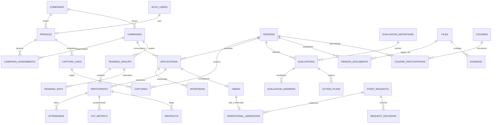

# Talent-On — preparación relacional Supabase

Fecha: 12/10/2026. Alcance: SQL y pruebas aisladas, no activación. **No se ejecutó SQL remoto, migró información, creó cuentas ni cambió Firebase, login, Worker operativo o interfaces.**

## Auditoría y diferencias

Fuentes: docs/CHATGPT_PROJECT_CONTEXT.md, src/types.ts, TalentContext, App, servicios capture/selection/workerApi/firebase/supabase, Worker index/capture/selectionAdvanced/supabase, firestore.rules, auditoría de BBDD, migración 001, scripts y tests. El contexto maestro tiene validaciones antiguas: no se toman sus conteos de pruebas/vulnerabilidades como evidencia actual.

Hallazgos:

1. La migración 001 y adaptadores anteriores son documentales, no relacionales. El límite único persona/empresa impediría postulaciones simultáneas legítimas. Se conserva ese archivo por historial y se agrega modelo independiente; NO usar sus RPC ni bootstrap documental para este modelo.
2. Firebase llama campaigns a una entidad que combina campaña/convocatoria (CampaignCall). No hay una entidad operacional distinta confirmada. Se conserva una entidad campaigns: separar cliente/campaña/convocatoria nuevamente requiere definición, no crear duplicados ficticios.
3. CandidateRecord guarda selección, formación y contratación dentro de la persona y arrays crecientes. Se extraen relaciones explícitas sin copiar información. La aplicación actual mantiene un único proceso activo en su proyección: el esquema permite varios por convocatoria, pero el frontend aún no los soporta simultáneamente. Resolver en fase de adaptación, no ahora.
4. Roles existentes: nueve; módulos: cinco. Calidad/Aprendizaje/Operaciones no tienen endpoints, contratos completos o roles propios en el código examinado. Se preparan entidades solicitadas reutilizando personas/evaluaciones/archivos; **sin habilitar permisos o inventar algoritmos de aprobación/calidad**.
5. Firestore permite excepciones ADMIN globales y contiene distintos mecanismos scope/assignedAnalystId/assignedUserIds. El nuevo SQL no habilita acceso global implícito: incluso ADMIN opera con empresa explícita y perfil de esa empresa. La futura compatibilidad multiempresa de ADMIN necesita aprobarse.
6. Desbloqueos antiguos pueden durar indefinidamente. El nuevo modelo exige expiración explícita al aprobar; su duración máxima no está definida y debe acordarse antes de activarlo.

## Estructura implementada

67 tablas normalizadas en schema talent; relaciones principales mediante FK compuestas por empresa. Diccionario completo de 780 columnas y restricciones: [SUPABASE_DICCIONARIO.md](SUPABASE_DICCIONARIO.md). Las migraciones son la fuente de verdad de defaults, índices y checks.

- Administración: companies, sites, areas, profiles, roles, modules, role_permissions, user_modules, campaign_assignments, supervision, access_events.
- Personas/captación: persons, person_identifiers, identity_conflicts, recruitment_sources, capture_links, captures.
- Selección: campaigns, applications, process_templates/stages/responsibles, interviews, technical_verifications, contacts, message_templates/messages, observations.
- Operaciones: staff_requests, request_decisions, request_campaigns, operational_admissions y vista request_coverage.
- Formación/OJT: training_groups, participants, training_days, attendance/unlocks, dropouts, ojt_metrics/skills, feedback, lifecycle_events.
- Evaluación compartida/Calidad: evaluation_definitions/items/options, evaluations/answers, calibrations/results, action_plans. Pautas/rúbricas y encuestas reutilizan definiciones versionadas; evidencias/audio reutilizan archivos.
- Aprendizaje: courses/materials, learning_paths/path_courses, course_participations/learning_evaluations.
- Talento/documentación: hiring, salary_accounts, files, person_documents, evidence.
- Soporte: system_settings, audit_events, idempotency, migration_runs/mappings, auth_mappings.

JSONB limitado a configuración, reglas flexibles, ratings complementarios y respuesta idempotente. No contiene personas/postulaciones/grupos completos. No se persisten contadores dashboard como fuente primaria. SPH/conversión/progreso se calculan desde datos originales; sus fórmulas actuales no cambian.

## Diagrama de relaciones

FK de tenant impide referencias entre empresas; PK lógica estable. Auth UUID separado de UID Firebase en auth_mappings. No cascadas de borrado. verified identity única por empresa/tipo/número; teléfono/email solo índices para revisión, nunca fusión automática. Varias captaciones/persona y varias postulaciones/persona, unicidad parcial únicamente para el mismo par persona+convocatoria activo.

## Matriz de permisos

| Actor | Lectura/escritura directa | RPC habilitadas en esta preparación | Alcance |
|---|---|---|---|
| anon / authenticated | Ninguna | Ninguna | Denegado |
| service_role | Ninguna en talent | schema_status, group_page, request_transition, unlock_decide | Worker verifica token y deriva actor UUID |
| ADMIN | No privilegio SQL directo | Grupos; desbloqueos | Solo empresa de perfil; no aprobación RQ |
| JEFE_SELECCION | No privilegio SQL directo | Decisiones RQ | Empresa + módulo Selección |
| ANALISTA_SELECCION / RECLUTADOR | No privilegio SQL directo | Sin lectura global; solicitante puede enviar su RQ | Asignación/campaña; futuros endpoints pendientes |
| JEFE_FORMACION | No privilegio SQL directo | Grupos/desbloqueos | Empresa + módulo Formación |
| COORDINADOR_FORMACION | No privilegio SQL directo | Grupos/desbloqueos | Campaña asignada o grupo coordinado + módulo |
| FORMADOR | No privilegio SQL directo | Solo group_page | trainer_id/ojt_trainer_id actual; no decisión desbloqueo |
| JEFE_TALENTO / ANALISTA_TALENTO | No privilegio SQL directo | Aún sin CRUD RPC | Contratos de adaptación futuros |
| Calidad/Aprendizaje/Operaciones | Ninguna concesión automática | Pendiente | Roles/alcance por definir |

RLS está activo, schema privado no expuesto en PostgREST y no hay políticas públicas. Las RPC SECURITY DEFINER tienen search_path fijo y EXECUTE solo service_role. Actor no se obtiene de roles enviados por cliente: el backend futuro debe derivarlo del token verificado. La service key necesita siempre validación explícita en servidor; SQL no verifica el token HTTP por sí mismo.

Las funciones require_campaign/actor_profile son privadas y no dan acceso a browser. role_permissions es catálogo preparatorio parcial, no permiso universal ni sustituto del backend. No se ha conectado ninguna de estas RPC a Talent-On.

## Concurrencia, auditoría e integridad

- RQ: bloqueo de fila, expected version, transiciones explícitas, decisiones append-only, idempotencia con key/payload y auditoría en misma transacción. Solo JEFE_SELECCION decide aprobación/observación/rechazo. Reintento devuelve resultado anterior; otra carga con misma key falla.
- Cobertura: solo operational_admissions con contratación CONTRATADO y inicio oficial; hiring único impide doble conteo. Cubierto exige pendientes cero. No se cuentan inscritos, aptos ni grupos de capacitación.
- Attendance: calendario explícito; hora PostgreSQL; apertura inicio a +30 min. Fuera de ventana solo autorización aprobada, no expirada y mismo grupo/fecha. El histórico de asistencia ya existente no se migra. Unlock decision CAS, autorización servidor y auditoría atómica.
- Versiones se incrementan en updates; identidad/empresa inmutables; auditoría registra columnas cambiadas, no PII. Otras futuras RPC CRUD deben exigir CAS y auditoría; no hay un write-json universal.
- FK relacionales, contexto persona/evaluación, participante/grupo/campaña, contratación/postulación, opción/ítem/definición.
- Índices por empresa, campaña, propietario, formador, fecha, estado y FK. Cursor de grupos estable por ID. Sin particiones/cache/materializaciones.
- Archivos R2: key privada, MIME/tamaño/checksum, estado pending/available/failed. Consistencia física de objetos requiere futuras operaciones compensadas y reconciliación R2; una FK no verifica existencia del objeto.

## Mapeo Firebase → PostgreSQL

| Origen | Destino | Observación |
|---|---|---|
| companies | companies | IDs lógicos conservados |
| users / Firebase Auth | profiles / auth_mappings / user_modules / campaign_assignments / supervision | UUID Auth futuro separado del UID Firebase; sin passwords en DB |
| campaigns | campaigns / campaign_assignments / recruitment_sources / message_templates | campaigns corresponde hoy a convocatoria |
| candidates datos personales | persons / person_identifiers | persona no depende de una única convocatoria |
| candidates.selection / selectionApplications | applications / interviews / technical_verifications / evaluations / contacts / observations / lifecycle_events | extraer por participación; evitar duplicar snapshot y proyección |
| captureLinks / captations | capture_links / captures / identity_conflicts | token externo opaco; propietario/fuente internos |
| captureIdentities / captureRequests / captureRateLimits / captureAudit | person_identifiers / idempotency / futura política rate-limit / audit_events | rate-limit del Worker sigue intacto; TTL nuevo pendiente |
| selectionTemplates / selectionTemplateFamilies | process_templates / process_stages / template_responsibles / evaluation_definitions | familia+revisión explícitas |
| selectionMessages | message_templates | separar plantilla de envío |
| trainings + participants | training_groups / participants / training_days | no reutilizar contadores como fuente primaria |
| candidates.training | attendance / evaluations / dropouts / lifecycle_events | históricos mantienen fechas/estados |
| attendanceUnlockRequests | attendance_unlocks / audit_events | política nueva de expiración necesita aprobación funcional |
| candidates.ojt | ojt_metrics / ojt_skills / feedback | no almacenar indicadores calculables como fuente primaria |
| candidates.hiring / hiringProcesses | hiring / operational_admissions | conciliar antes de importar; no escoger una copia arbitrariamente |
| candidates.documents + subcolección documents | person_documents / files / evidence | conciliar duplicados, no borrar objetos |
| candidates.salaryAccount | salary_accounts | datos privados, sin grants browser |
| systemSettings | system_settings | configuración justifica JSONB |
| auditLogs | audit_events / lifecycle_events / request_decisions | compatibilidad de autores históricos mediante mapping |

migration_mappings es manifiesto de correspondencias, no importador automático; target_table/target_id necesitan validación por el futuro importador. migration_runs guarda hash/estado para reconciliación y respaldo. Nada de esto se ejecuta en esta fase.

## Compatibilidad por módulo y decisiones pendientes

| Módulo | Fuentes preparadas | Pendiente antes de conexión |
|---|---|---|
| Administración | Perfil/Auth, módulos/asignaciones/auditoría | Adaptar CRUD seguro; definir administrador multiempresa |
| Captación | Persona ≠ evento ≠ enlace ≠ fuente | Normalizar/hash tokens; TTL/rate limits y conflictos heredados |
| Selección | Postulación por convocatoria y evaluaciones versionadas | Desacoplar currentSnapshot singular; conservar enums/entrevistas/traceability |
| Operaciones | RQ, decisiones y altas confirmadas | Rol solicitante, creación/edición, política prioridad y sobredotación |
| Formación/OJT | Calendario, participantes, asistencia/resultados | Adaptar CRUD; criterios finales y expiración máxima de desbloqueo |
| Talento | Contrato, cuenta sueldo, expediente, alta | Conservar calculateEligibility; no permitir alta arbitraria |
| Calidad | Evaluaciones/rúbricas, evidencia, calibración/planes | Roles, cálculo/ponderación/validación por definir |
| Aprendizaje | Catálogo/rutas/participaciones/evaluación reutilizada | Progreso/material obligatorio y roles por definir |
| Analítica | Relaciones fuente | SQL agregado validado contra fórmulas actuales; todavía no hay dashboard conectado |

No se impone duración 5+5 universal: theory_days/ojt_days/calendario mantienen modalidades e históricos. Fechas nulas/campos históricos incompletos requieren informe de calidad previo, no completar ficticiamente.

## Aplicación segura

1. Revisar SQL/diccionario/permisos y decisiones anteriores. Desactivar signup en proyecto nuevo. No usar bootstrap documental antiguo.
2. Ejecutar workflow Supabase en PostgreSQL 17 y exigir su check antes del merge. El workflow existe pero configurar protección de rama requiere acción GitHub; no se ha cambiado.
3. Crear proyecto de ensayo sin datos reales. Respaldar entorno destino si contiene objetos/datos y validar recuperación antes de modificarlo.
4. Aplicar archivos migration/*.sql en orden con el mecanismo de migraciones Supabase, solo tras autorización del entorno destino. La 001 no se reescribe. Si ya fue aplicada, aplicar solo pendientes 002/003/004 mediante historial del migrador.
5. Verificar talent_schema_status y aislamiento. Nunca aplicar tests/bootstrap.sql en Supabase real: crea roles/auth.users ficticios, exclusivamente para CI.
6. No activar módulos ni cuentas. Plan de cutover/importación/pruebas funcionales es otra fase. Los adaptadores y scripts documentales anteriores no son compatibles con talent relacional.

Los SQL nuevos no contienen DROP TABLE/TRUNCATE ni copia histórica. Rollback operacional: detener cambio y restaurar respaldo probado si fuera necesario; no eliminar tablas/datos automáticamente.

## Evidencia de pruebas y límites

- Migraciones 001–004 e invariants.sql/relational.sql ejecutadas realmente sobre PostgreSQL 17.5 WASM (PGlite) aislado, no mocks y no servidor Supabase.
- Fixtures cubren todas las 67 tablas. Negativos: FK tenant, unicidad, identidad verificada, propietarios inmutables, borrado, puntajes/contextos, asistencia bloqueada, autorizaciones, versión obsoleta, replay, doble alta y auditoría.
- Workflow PostgreSQL 17 aplica todas las migraciones y ejecuta concurrency.py: dos sesiones, un ganador CAS, rollback del perdedor y reintentos concurrentes idempotentes. **No ejecutado remotamente en esta intervención**. WASM no prueba multisesión.
- Docker local no inicia (pipe DockerDesktopLinuxEngine ausente); SQL se verificó sin Docker. PostgreSQL 17.5 WASM no sustituye prueba Supabase PostgREST/RLS/Auth real.
- Sin pruebas remotas de datos ni verificación física R2. No afirmar funcionalidad de módulos futuros por existir tablas. Las pruebas de backend/frontend actuales no prueban integración Supabase.
- Frontend typecheck/build y Worker typecheck: PASS. Worker 71/71 pruebas PASS (regresión existente, no integración relacional). Build conserva advertencia de chunk Firebase >500 kB.

Reproducción SQL aislada sin dependencias del app: instalar @electric-sql/pglite@0.3.16 en carpeta temporal, definir PGLITE_MODULE a su dist/index.js y ejecutar node supabase/tests/run-embedded.mjs desde la raíz. El runner no carga .env ni conecta al proyecto remoto. Referencia de ejecución SQL: [API oficial PGlite](https://pglite.dev/docs/api).
