# Multiempresa — preparación técnica, 12 octubre 2026

> Documento de diseño de la preparación original. **El estado vigente de implementación y aplicación remota está en [SUPABASE_MULTIEMPRESA_EJECUCION.md](SUPABASE_MULTIEMPRESA_EJECUCION.md)**. Las referencias siguientes a migraciones no aplicadas y adaptador futuro describen la primera etapa, no el estado actual.

## Estado y diagnóstico

Migración nueva `202610120007_multiempresa_prepared.sql`: **no aplicada a producción**. Sin migrar registros, reactivar Firebase, cambiar Auth, navegación o colores. El prompt describe una etapa anterior a la transición: se respeta su restricción de preparar y probar solamente.

El modelo vigente tiene una sola empresa por perfil y `auth_user_id` único. Convocatorias, personas, postulaciones, formación, asistencia, notas, OJT, altas y trazas usan `company_id` y FK compuestas; las guardas de contexto de 003/004/006 validan campaña, participante y grupo. No existía una definición global de campaña, pertenencia usuario-múltiples empresas ni un administrador global separado. Firebase histórico usa `companyId`, scopes y grupos, pero su excepción ADMIN global no debe copiarse como autorización automática.

## Diccionario incremental

| Entidad | Identidad / relaciones | Uso |
| --- | --- | --- |
| `talent.companies` | ID estable; nuevos `status`, `legal_name`, `tax_id`, `catalog_managed`, metadatos | Dimensión empresarial, no marca de interfaz. El control de catálogo es configurable para futuras empresas, no una lista hardcodeada. Razón social/RUC requieren información legal real; no se inventan. |
| `talent_org.global_campaigns` | ID global único; nombre único | Cuatro definiciones iniciales compartidas, extensibles por RPC con CAS. |
| `company_campaigns` | PK empresa/ID; único empresa/campaña global | Ocho autorizaciones iniciales y configuración operativa propia. |
| `user_companies` | FK a identidad Auth del perfil; único empresa/usuario | Rol por empresa y acceso habilitado explícitamente; todas las campañas desactivado por defecto. |
| `user_campaigns` | FK compuestas a membresía y asociación empresa-campaña | Campañas expresamente autorizadas. |
| `global_admins` | FK al usuario Auth del perfil | Consolidado/administración global explícitos. Ningún usuario se incorpora automáticamente. |
| `identity_registry` | ID opaco, fingerprint HMAC de servidor único | Dedupe controlado, sin PII global. Sin SELECT para navegador ni RPC pública de búsqueda. |
| `quality_reviews` | Empresa/campaña, postulación y miembro Calidad compatibles | Preparación de evaluación/feedback contextual, sin activar módulo UI. |
| `audit_events` | Actor Auth, empresa, columnas cambiadas, fecha | Append-only sin valores de PII; registra modificaciones de catálogos/asignaciones. |
| Convocatorias / captación | `company_campaign_id` compuesto | Obligatorio para los tres nuevos tenants. Filas históricas siguen sin asociación: no se reclasifican. |
| Personas | `shared_identity_id` opcional | Vinculación futura controlada; no cambia una identidad ya vinculada. |

Talent Up: Portabilidad Bitel, Migraciones Bitel, Internet Win. Techcenter: Portabilidad Bitel, Migraciones Bitel, Portabilidad Movistar. Konectados: Portabilidad Bitel, Migraciones Bitel. No hay campañas nuevas habilitadas en otras empresas.

## Relaciones

```mermaid
erDiagram
 GLOBAL_CAMPAIGN ||--o{ COMPANY_CAMPAIGN : autorizada
 COMPANY ||--o{ COMPANY_CAMPAIGN : configura
 AUTH_PROFILE ||--o{ USER_COMPANY : pertenece
 COMPANY ||--o{ USER_COMPANY : asigna
 USER_COMPANY ||--o{ USER_CAMPAIGN : limita
 COMPANY_CAMPAIGN ||--o{ USER_CAMPAIGN : habilita
 COMPANY_CAMPAIGN ||--o{ CONVOCATORIA : contextualiza
 CONVOCATORIA ||--o{ POSTULACION : recibe
 POSTULACION ||--o{ PARTICIPANTE : forma
 PARTICIPANTE ||--o{ ASISTENCIA_EVALUACION_OJT : registra
 POSTULACION ||--o{ CONTRATACION_ALTA : culmina
 POSTULACION ||--o{ QUALITY_REVIEW : revisa
 SHARED_IDENTITY ||--o{ PERSONA_POR_EMPRESA : vincula
```

## Matriz de autorización preparada

| Rol | Empresa/campaña | Restricción adicional |
| --- | --- | --- |
| Administrador global | Registro explícito en global_admins | No nace de role=ADMIN, sin acceso global por defecto. |
| ADMIN de empresa | Membresía activa + campañas explícitas o all_campaigns autorizado | No puede administrar otra empresa ni otorgarse permiso global. |
| Jefatura Selección | Empresa y campañas expresamente autorizadas | No se hereda alcance global del rol histórico. |
| Coordinador Operaciones | Empresa/campañas propias | Rol preparado; sin endpoints/UI nuevos activados. |
| Reclutador | Empresa/campañas propias | Preservar propiedad de captaciones y postulaciones en el adaptador futuro. |
| Formador | Empresa/campañas propias | Esto NO sustituye asignación del grupo: runtime debe exigir además trainer_id. |
| Calidad | Empresa/campañas propias | La tabla preparada verifica rol CALIDAD activo y campaña de la postulación. |

RLS permite exclusivamente lectura acotada de catálogos y propias membresías. No concede escritura desde React ni lectura de PII; los datos operativos existentes conservan su RLS deny-by-default y RPC de servicio. El Worker deberá validar el ID Token y pasar el actor verificado, nunca un actor del body. No confiar en que service_role aplica RLS: tiene bypass y exige controles servidor/RPC.

## Analítica / concurrencia

`talent_org_summary` es RPC de servicio, valida permisos y limita campañas. Consolidado sin empresa exige global_admin explícito. Cuenta personas DISTINCT por identidad compartida, si existe, y por identidad empresarial de lo contrario; sin vinculación validada no se puede garantizar deduplicación de la misma persona entre tenants. Altas/contrataciones y requerimientos se cuentan desde sus relaciones, sin joins multiplicadores. No entrega datos personales ni fingerprints.

`talent_org_catalog_save` permite ampliar campañas/asociaciones sin cambios de código: autorización global explícita, advisory lock y CAS de versión. No sustituye un formulario de Administración ni provee autoasignación de permisos. Índices sobre empresa/campaña/usuario/fecha; el esquema anterior conserva sus índices de responsable y ciclo operativo. Identificadores empresariales/relaciones vinculadas inmutables, borrado histórico prohibido y auditoría de columnas. Transferencias no implementadas: se rechazan y requieren procedimiento separado.

## Compatibilidad y activación pendiente

1. No tocar migraciones 001–006 aplicadas. Ejecutar 007 primero en staging con respaldo verificado; si IDs/nombres iniciales ya existen, detenerse y revisar, nunca sobrescribir.
2. No llevar los datos actuales al nuevo catálogo silenciosamente. Clasificar y autorizar cada correspondencia por separado.
3. El perfil operativo actual sigue con empresa única. Antes de activar operación multiempresa, adaptar las FK de responsables/formadores/solicitantes al contexto de membresía, mediante migración explícita y pruebas; hoy referencian `profiles(company_id,id)` y no permiten actuar fuera de la empresa hogar. No crear perfiles Auth duplicados para evadirlo.
4. Preparar endpoints Worker de catálogo, membresías y selector de contexto empresarial, con auth/RBAC verificados y sin cambiar login. No hay conmutación automática del runtime 006 al esquema org.
5. Integrar formulario Administración y documentos con razón social real. Los contratos actuales no se reescriben; no declarar legal_name válido mientras no se confirme.
6. Mantener acceso a personas solo dentro de su empresa/participación. Cualquier servicio de duplicados debe devolver un resultado mínimo controlado, no identidad ajena.

Resultado de esta fase: estructura y pruebas preparadas; **no afirmar que la UI ya opera entre las tres empresas**. No se desplegó ni se ejecutó SQL contra Supabase remoto.

## Pruebas

- PostgreSQL 17 embebido: migraciones nuevas y anteriores; RLS de lectura por usuario/campaña, FK cruzada, ausencia de admin global automático, múltiples membresías, CAS y auditoría.
- SQL dedicado `supabase/tests/multiempresa.sql`, incluido en workflow PostgreSQL 17; las pruebas históricas siguen incluidas. Resultado CI remoto pendiente hasta publicar/ejecutar ese workflow.
- Regresión Worker/frontend: typecheck, build y pruebas actuales. No son E2E de navegador ni test de performance a escala.
